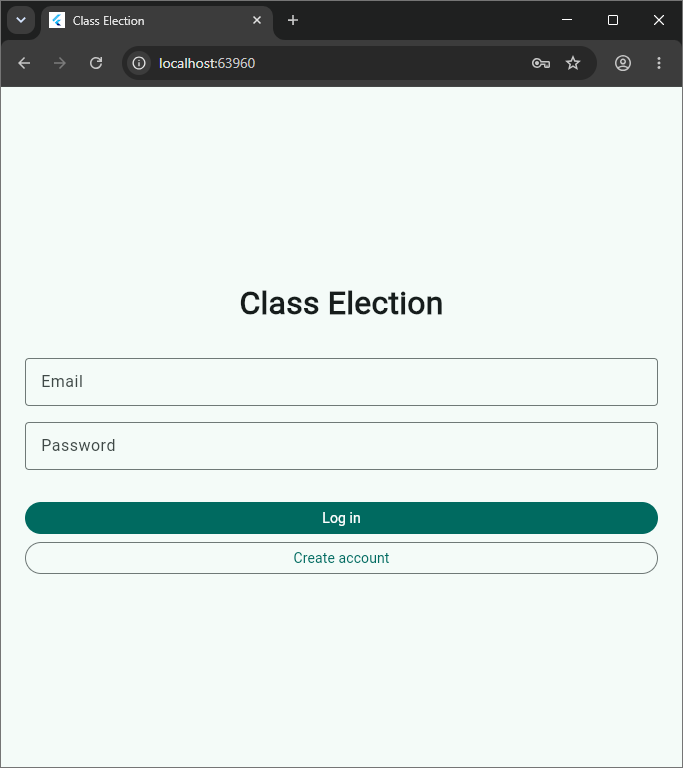
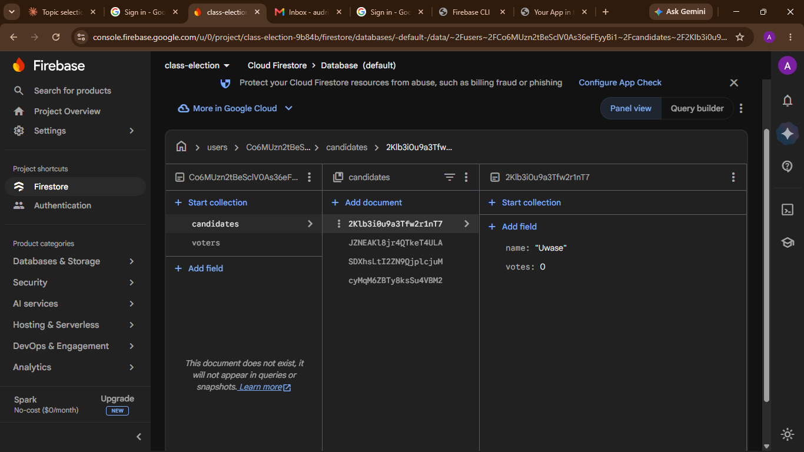
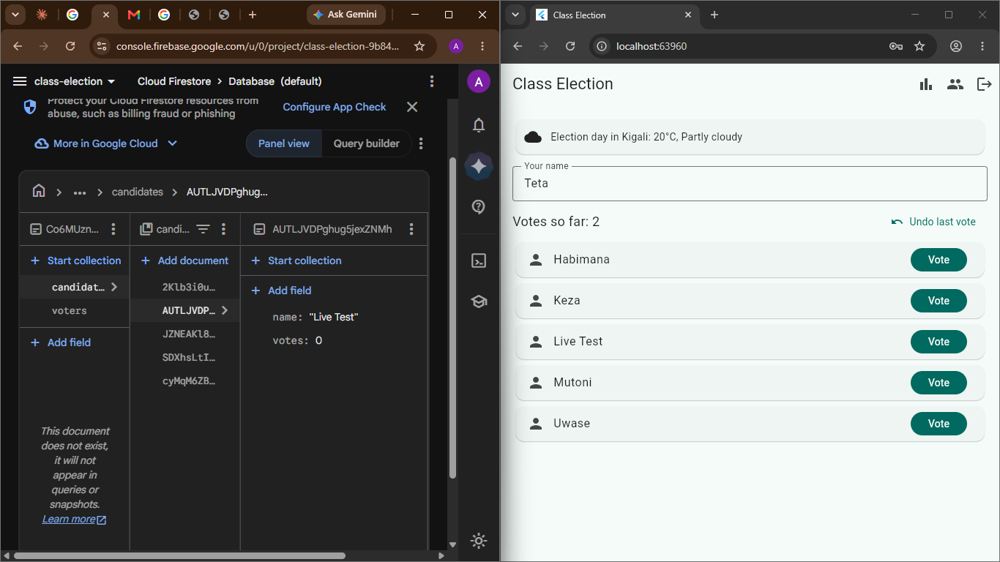
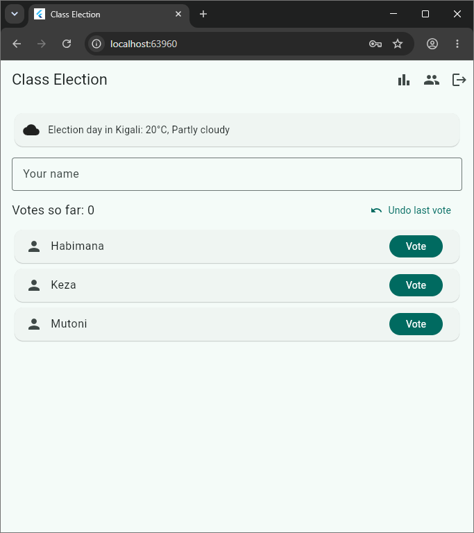

# Class Election

A Flutter app where a class elects its representative. It signs users in with Firebase Authentication, and each user's data is saved in Cloud Firestore under their own id, so two accounts never see each other's data, and every change appears live.

## Screenshots






## Features
- Create an account, log in and log out, with clear messages for wrong input
- Vote screen: type your name, tap Vote on a candidate, undo the last vote
- Names are cleaned (extra spaces removed, Title Case), so each voter votes only once
- Results screen: ranked candidates with votes, percentage and a bar, and a banner for the winner or a tie
- Candidates screen: add, remove (only with 0 votes), set the class size, reset all votes
- Live updates on every screen, with loading, error and empty states
- Live weather badge from the Open-Meteo API

## How the data is stored
- `users/{uid}/candidates`: `name`, `votes`
- `users/{uid}/voters`: `name`, `candidateId`, `createdAt`
- `users/{uid}/settings/election`: `classSize`

Percentages, ranking, the winner or tie and the turnout are worked out from this data each time it arrives.

## Firestore rules

```
match /users/{userId}/{document=**} {
  allow read, write: if request.auth != null && request.auth.uid == userId;
}
```