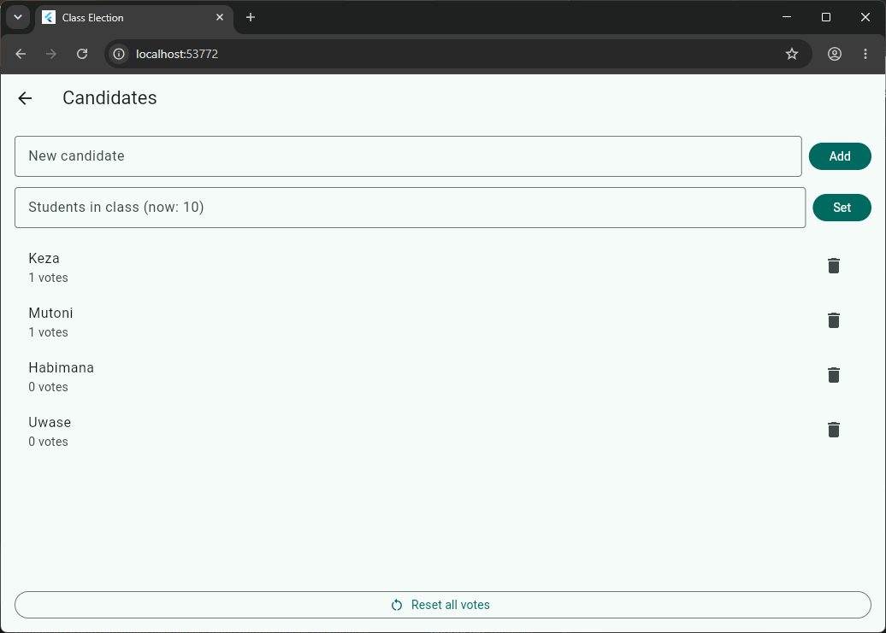
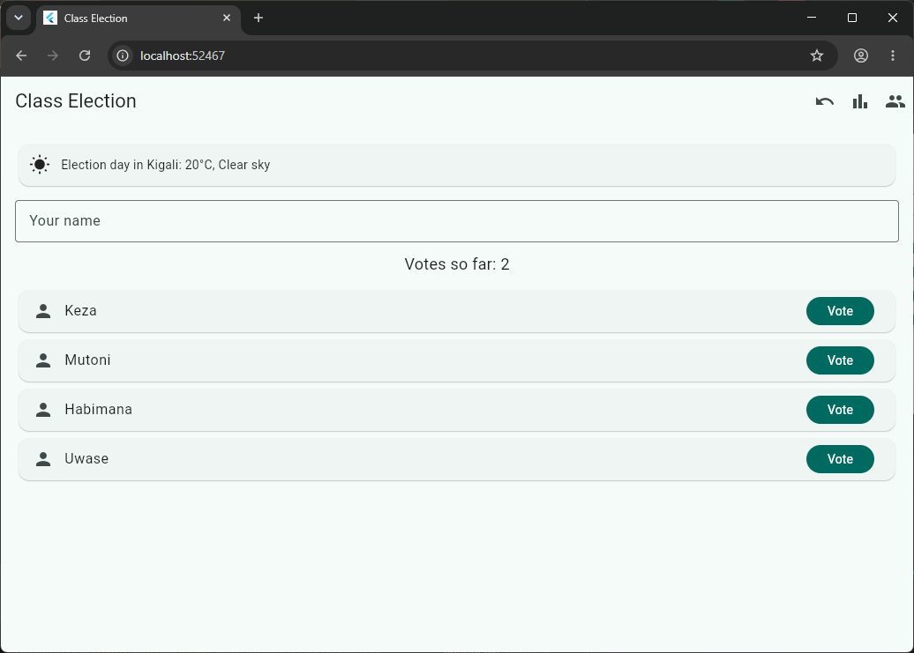
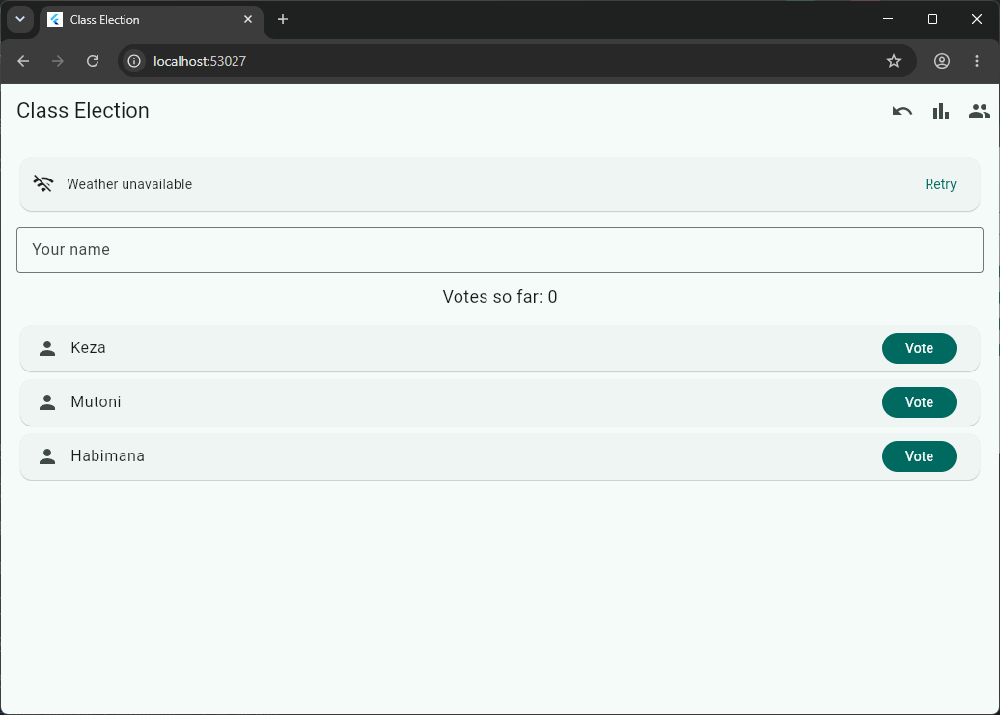

# Class Election

A Flutter app where a class elects its representative. My data is now saved on the phone with shared_preferences, so nothing is lost when the app closes, and it shows the current weather in Kigali from the Open-Meteo API.

## Screenshots

## Features
- Vote screen: type your name, tap Vote on a candidate
- Names are cleaned (extra spaces removed, Title Case) before use
- Each voter can vote only once (aline and ALINE are the same voter)
- Results screen: ranked candidates with votes, percentage and a bar
- Banner shows the winner or a tie; "No votes yet" before any vote
- Candidates screen: add (no empty or duplicate names) and remove (only with 0 votes)
- Reset all votes with an "Are you sure?" dialog
- Undo last vote
- Turnout: votes cast out of the class size
- Saves everything on the phone with shared_preferences
- Live weather badge with three states: loading, error with Retry, and data

## Think questions

**1. Why must names be cleaned before they are compared?**

The computer compares text letter by letter, so "aline" and " ALINE " are different strings even though a person sees one name. Without cleaning, the same student could vote twice, or I could add "keza" when "Keza" already exists. So every name is cleaned first, then compared.

**2. How does your app decide between a winner and a tie?**

If nobody has voted, it says "No votes yet". Otherwise it finds the highest vote count, collects every candidate with exactly that score, and if there is one it is the winner, and if there are two or more it is a tie.